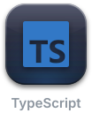
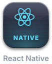
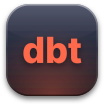
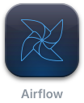
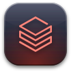
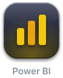
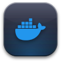
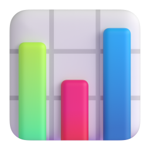

#  Salut, moi c'est Harold Brian Fotseu

**Développeur informatique & Data Engineer · CEO @ Top Nyanga · CTO @ MK Sarl · Co-fondateur @ Gesta**

---

##  À propos de moi

- Je conçois des applications web et mobile de bout en bout : interfaces, APIs, backend et déploiement
- CEO de **[Top Nyanga](https://topnyanga.com)**, application de réservation beauté au Cameroun : coiffure, maquillage, manucure à domicile ou en salon, et boutique de produits
- CTO de **[MK Sarl](https://momscompanys.com)** (Mom's Company), entreprise de services à Yaoundé : pressing, placement du personnel, études à l'étranger, immobilier, construction et applications web
- Co-fondateur de **Gesta**, agence tech basée entre Douala/Yaoundé et Paris, où je pilote le développement depuis 2024
- En Mastère **Data Engineer & Cloud** à l'ESSIN Paris (2025 – 2027)
- Basé à Reims, France
- Je relie le développement produit et l'ingénierie data : de l'application mobile au pipeline analytique

---

##  Stack technique

#### Langages & Frameworks

  
  
  
  
  
  
  
  
  
  
  

#### Data Engineering

  
  
  
  
  
  
  
  

#### DevOps, Cloud & Outils

  
  
  
  
  
  
  

---

##  Parcours professionnel

| Période           | Rôle                    | Organisation                                                                                                                             | Réalisations clés                                                                                                                                 |
| ----------------- | ----------------------- | ---------------------------------------------------------------------------------------------------------------------------------------- | ------------------------------------------------------------------------------------------------------------------------------------------------- |
| Depuis sept. 2026 | Développeur             |  **[Mately](https://mately.gg)** (Reims)                     | Application de mise en relation entre joueurs · React Native, Expo, TypeScript                                                                    |
| Depuis mars 2024  | CEO                     |  **[Top Nyanga](https://topnyanga.com)** (Cameroun)      | Direction du produit et de l'équipe · Application mobile iOS/Android, backend, dashboard et site · Réservation, boutique et paiement Mobile Money |
| Depuis fév. 2024  | Co-fondateur & Lead Dev |  **[Gesta](https://groupgesta.com)** (Douala/Yaoundé · Paris) | Interfaces, APIs, backend et déploiement · Sites vitrines, plateformes métier et applications mobiles pour des clients                            |
| Depuis janv. 2024 | CTO                     |  **[MK Sarl](https://momscompanys.com)** (Yaoundé)          | Direction technique de Mom's Company · Site vitrine Next.js, applications web et mobiles pour les marques du groupe et ses clients                |

---

##  Projets

| Projet                                                                                        | Description                                                                                                                                                                                                                                                                          | Stack                                                            |
| --------------------------------------------------------------------------------------------- | ------------------------------------------------------------------------------------------------------------------------------------------------------------------------------------------------------------------------------------------------------------------------------------ | ---------------------------------------------------------------- |
| [**Phileo**](https://phileo.gestafly.com)                                                     | Sites de mariage : programme, RSVP, billets sur WhatsApp, plan de salle et accueil le jour J, en français et en anglais                                                                                                                                                              | Next.js, React 19, Tailwind CSS, Motion, MongoDB                 |
| [**Mately**](https://mately.gg)                                                               | Application de mise en relation entre joueurs : profil, annonces et recherche de coéquipiers sur ses jeux                                                                                                                                                                            | React Native, Expo, Node.js, Express, MongoDB, Socket.IO         |
| [**olist_analytics**](https://github.com/HaroldBrian/Pipeline-ELT-SNOWFLAKE-DBT-OLIST_MARKET) | Pipeline analytique complet sur le dataset e-commerce brésilien Olist (couches staging → marts)                                                                                                                                                                                      | dbt, Snowflake, SQL                                              |
| **Pipeline Databricks · NYC Taxi**                                                            | Pipeline end-to-end en Medallion Architecture sur les trajets réels des taxis de New York : ingestion Parquet en Delta Lake (Bronze), nettoyage et enrichissement géographique (Silver), modèle analytique (Gold), orchestration par Workflows Databricks et dashboard Looker Studio | Databricks, PySpark, SQL, Delta Lake, Looker Studio              |
| [**Top Nyanga**](https://topnyanga.com)                                                       | Application de réservation beauté : prestataires triés par distance, réservation en 3 étapes, boutique en ligne, paiement Orange Money / MTN MoMo                                                                                                                                    | React Native, Expo, NestJS, Prisma, Google Maps                  |
| [**momscompanys.com**](https://momscompanys.com)                                              | Site vitrine de Mom's Company : pressing, recrutement, études à l'étranger, immobilier, construction · Une page par service, SEO, contact WhatsApp                                                                                                                                   | Next.js, TypeScript, Tailwind CSS                                |
| [**MomsEduc Study**](https://momseduc.com)                                                    | Accompagnement des étudiants internationaux : AVI, démarches de visa, logement · Backoffice de suivi des dossiers, attestations PDF et API                                                                                                                                           | React, Tailwind CSS · Symfony, API Platform, EasyAdmin, Doctrine |
| [**groupgesta.com**](https://groupgesta.com)                                                  | Site de l'agence : mode sombre premium, mega-menu, timeline animée, design tokens adaptatifs                                                                                                                                                                                         | React, Vite, Tailwind CSS, Framer Motion, GSAP                   |
| [**GestaFly**](https://gestafly.com)                                                          | Générateur de badges et bannières d'événement avec photo, flyers, billets QR et gestion d'événements                                                                                                                                                                                 | React, Vite, TypeScript, Node.js, Express, MongoDB, Stripe       |

---

##  Formation

- **Mastère Data Engineer & Cloud** · ESSIN Paris · 2025 – 2027

---

##  Statistiques GitHub

---

##  Me contacter

